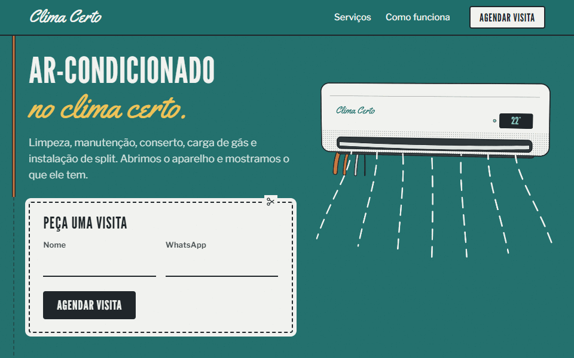

# Clima Certo

**Projeto conceitual de portfólio:** um site em que o scroll desmonta o ar-condicionado peça por peça, e cada peça explica um serviço.

**[Ver o site no ar](https://phaaek013.github.io/clima-certo/)**



A Clima Certo é uma marca fictícia, criada para este projeto. O cupom de pedido funciona em modo demonstração: monta a mensagem que chegaria no WhatsApp da empresa e não envia nada.

## A ideia

Sites de assistência técnica costumam ser iguais: azul e branco, foto de banco de imagens e uma grade de cards de serviço. Aqui o próprio aparelho é o menu de serviços. Quem rola a página vê o split funcionando, depois com defeito (pingando, esquentando, vibrando), e então aberto peça por peça:

| Peça | Serviço |
|---|---|
| Painel e filtros | Limpeza e higienização |
| Serpentina | Manutenção preventiva e PMOC |
| Turbina e dreno | Gotejamento e ruído |
| Placa eletrônica | Conserto e diagnóstico |
| Tubulação de cobre | Carga de gás e vazamentos |
| Chassi e suporte | Instalação |

No fim, as peças voltam ao lugar e o ar volta a sair.

O visual é o de um anúncio de eletrodomésticos das revistas brasileiras dos anos 50 e 60: campo turquesa, aparelho desenhado em corte com contorno preto e retícula, títulos em League Gothic e o nome da marca em letra cursiva. O coral aparece só na peça que está se abrindo. As peças que não estão em foco viram linhas tracejadas, como num desenho técnico.

## Como foi feito

- **Sem imagens nem vídeo:** o aparelho é um desenho em SVG dividido em sete camadas. Elas são montadas em 3D com CSS e afastadas conforme o scroll, tudo calculado em `site.js`.
- **Scroll:** o motor [scroll-craft](https://github.com/nateherkai/scroll-craft) fixa as seções e sincroniza os textos. O [Lenis](https://github.com/darkroomengineering/lenis) suaviza a roda do mouse.
- **Direção de arte:** escolhida com a skill [impeccable](https://github.com/ourslyio/impeccable), que também revisou o resultado em duas rodadas. A direção e o sistema visual estão documentados em `docs/`.
- **Responsivo:** no celular, o aparelho fica em cima, o texto embaixo, e as peças se afastam na vertical para caber na tela.
- **Movimento reduzido:** quem ativa "reduzir movimento" no sistema vê os estados sem animação.

## Rodar no computador

HTML, CSS e JavaScript puros, sem etapa de build:

```bash
npx serve .
```

## Usar com uma empresa de verdade

Preencha o número de WhatsApp em `site.js` (DDI + DDD + número, só dígitos). Com o número preenchido, o cupom passa a mostrar um link "Enviar pelo WhatsApp" com o pedido já escrito:

```js
var WHATSAPP = '5511999999999';
```

Troque também a linha de crédito do rodapé no `index.html`.

## Estrutura

| Arquivo | O que é |
|---|---|
| `index.html` | A página |
| `site.css` | O visual |
| `site.js` | O aparelho comandado pelo scroll, a linha de cobre e os cupons |
| `scrollcraft.js`, `scrollcraft.css` | Motor de scroll (não editar) |
| `lenis.css` | Estilos do Lenis; o script vem do jsDelivr |
| `fonts/` | League Gothic, Yellowtail e Libre Franklin, com as licenças |
| `docs/` | `PRODUCT.md` (perfil da marca), `DESIGN.md` (sistema visual), `BRIEF.md` (briefing) |
| `og.png` | Imagem de prévia para links compartilhados |
| `media/` | O GIF deste README |

## Créditos e licenças

Design e desenvolvimento: [Raphael Otávio](https://github.com/Phaaek013).

- Motor de scroll: scroll-craft, licença MIT (`LICENSE-scrollcraft.txt`).
- Scroll suave: Lenis, licença MIT.
- Fontes: League Gothic e Libre Franklin (SIL Open Font License 1.1), Yellowtail (Apache 2.0). As licenças estão em `fonts/`.
